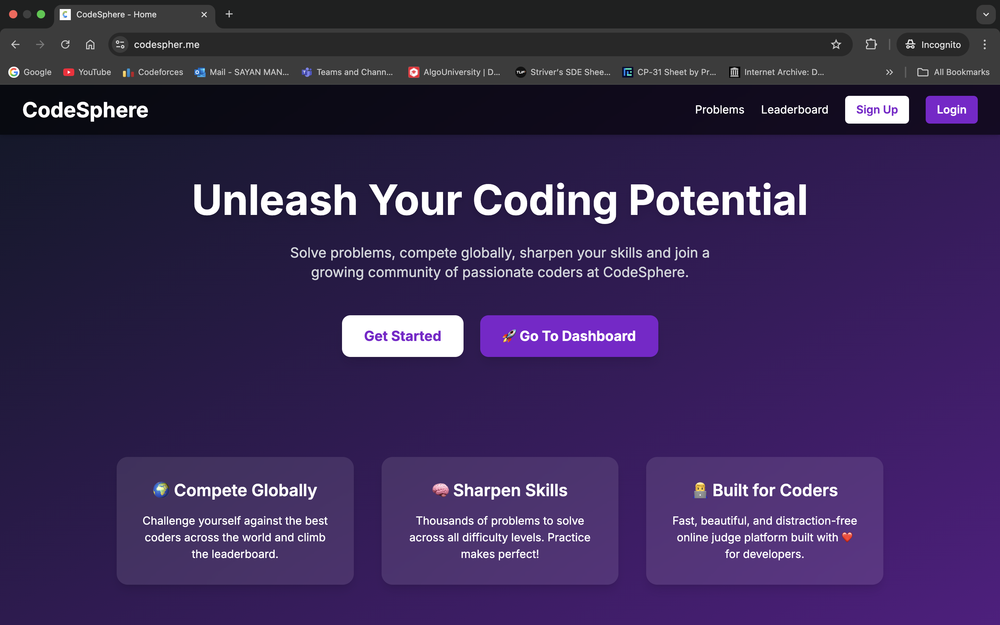
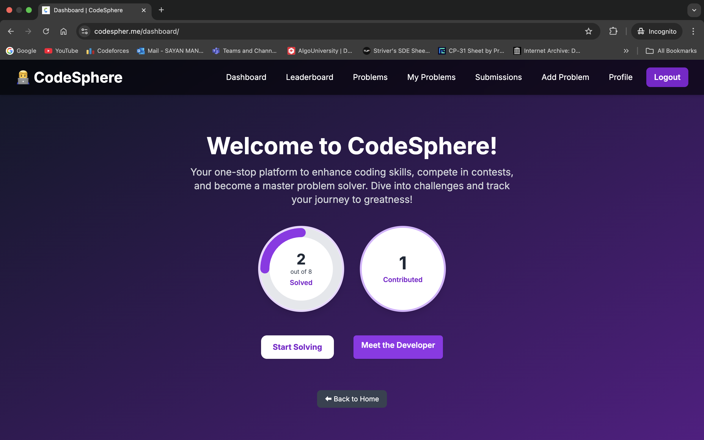
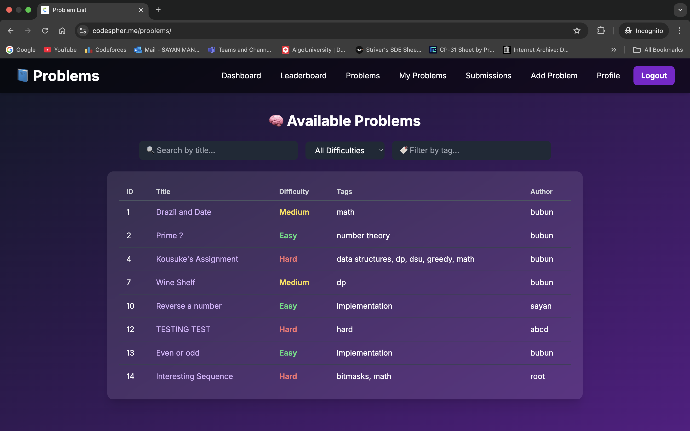
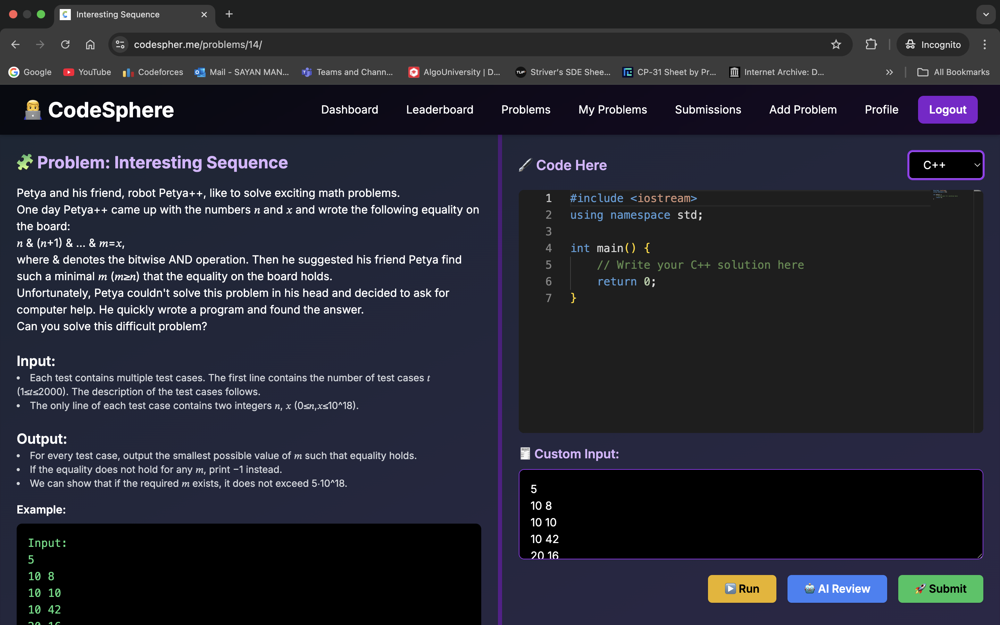
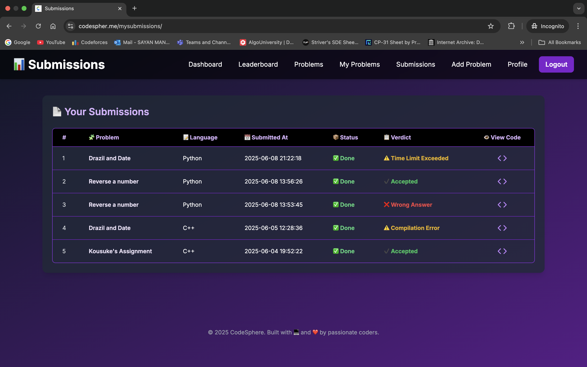

# 🧑‍⚖️ CodeSphere - Online Coding Platform
🔗 [Live Website](https://www.codespher.me)  
🎥 [Live Demo Video](https://www.loom.com/share/6e6c058402d240bcab52e2c7ff3ca1b5?sid=cf73ad9e-9228-49f4-b8c9-da2b8025a3ec)


CodeSphere is a web application that allows users to solve programming problems, compile code online, submit solutions for automated evaluation, and add problems — similar to platforms like Codeforces and LeetCode.

---
## 🖼️ Screenshots

### 🏠 Home Page   


### 📊 Dashboard Page 


### 📄 Problem Page  


### 💻 Code Area  


### 📑 Submission Page  



---
## 🏗️ Architecture

```
Browser (Monaco Editor + Tailwind CSS)
   │  HTTPS
   ▼
Nginx  ── TLS (Let's Encrypt), serves /static/, rate-limits run/submit
   │  HTTP
   ▼
Gunicorn ── Django 5.2 (accounts · problem · submission · coderunner)
   │  Docker API (/var/run/docker.sock)
   ▼
Sandbox container per run  ── codesphere-runner image (gcc, g++, JDK 17, Python 3, Node)
   --network none · --memory 256m · --cpus 1 · --pids-limit 128
   --read-only · --cap-drop ALL · no-new-privileges · user nobody
```

All of it ships as Docker images (`codesphere-web`, `codesphere-runner`) stored in
**Amazon ECR** and run on **AWS EC2** with Docker Compose.

## 📁 Project Structure

```bash
OJ/
├── backend/                 # Django project
│   ├── backend/             # settings (env-driven), urls, wsgi
│   ├── accounts/            # registration, login, dashboard, leaderboard, profile
│   ├── problem/             # problem CRUD
│   ├── submission/          # hidden test-case upload / download (author only)
│   ├── coderunner/          # run, submit, AI review
│   │   ├── sandbox.py       # Docker sandbox + judge (compile once, run each test)
│   │   └── judge_exec.py    # in-container wrapper: CPU-time limit, exit status
│   ├── templates/           # base template (Tailwind CSS)
│   ├── Dockerfile           # web image: Django + Gunicorn
│   ├── gunicorn.conf.py     # Gunicorn workers / timeouts / logging
│   └── entrypoint.sh        # migrate + collectstatic, then start Gunicorn
├── sandbox/Dockerfile       # runner image: compilers for C, C++, Java, Python, JS
├── deploy/
│   ├── nginx/               # codesphere.conf (HTTPS) and local.conf (HTTP)
│   ├── ecr_push.sh          # build + push both images to Amazon ECR
│   ├── ec2_bootstrap.sh     # one-time EC2 setup (Docker, AWS CLI, swap)
│   ├── ec2_deploy.sh        # pull from ECR, docker compose up
│   └── init_letsencrypt.sh  # first HTTPS certificate
├── docker-compose.yml       # nginx + web + runner
├── .env.example             # all configuration (secrets stay out of git)
└── DEPLOYMENT.md            # step-by-step AWS deployment guide
```

## ⚙️ Tech Stack

- **Backend:** Django 5.2 (Python), SQLite
- **Frontend:** Django templates, Tailwind CSS, Monaco Editor (VS Code's editor)
- **Code execution:** one throw-away Docker container per run/test, from a dedicated runner image
- **Serving:** Gunicorn (WSGI) behind Nginx (reverse proxy, TLS, static files, rate limiting)
- **Cloud:** AWS EC2 (host), Amazon ECR (image registry), Let's Encrypt (HTTPS)
- **AI:** Google Gemini code review
- **CI:** GitHub Actions (tests in the Docker sandbox, manual push to ECR)

---

## 🚀 Features

- Registration / login (Django auth, PBKDF2-hashed passwords, CSRF protection)
- Problems with difficulty and tags; authors add hidden test cases (file upload or paste)
- Monaco editor with **C, C++, Java, Python and JavaScript**
- **Run** on custom input: executed in the sandbox and shown instantly (AJAX, no page reload)
- **Submit**: compiled once, judged against every hidden test case, verdicts:
  Accepted · Wrong Answer on test *n* · Compilation Error · Runtime Error ·
  Time Limit Exceeded · Memory Limit Exceeded, with CPU time and tests passed
- AI code review (Gemini) that gives hints, not code
- Dashboard, leaderboard, submission history

## 🔒 Sandboxed execution

`backend/coderunner/sandbox.py` writes each submission to its own temporary
directory and runs the compiler and every test case in a **fresh container**:

| Limit | How |
| --- | --- |
| No network | `--network none` |
| Memory 256 MB (MLE) | `--memory 256m --memory-swap 256m` (cgroup OOM kill) |
| CPU time 2 s (TLE) | `judge-exec` sets `RLIMIT_CPU` and measures the program's own CPU time |
| No fork bombs | `--pids-limit 128` |
| Can't modify the system | `--read-only` root fs, code mounted read-only while running, `/tmp` is a small tmpfs |
| No privileges | `--user 65534` (nobody), `--cap-drop ALL`, `--security-opt no-new-privileges` |
| Nothing persists | `--rm`; the work directory is deleted after judging |

Tests in `backend/coderunner/tests.py` check each of these (network blocked,
write to `/etc` fails, uid is 65534, fork bomb contained, TLE, MLE, CE, RE).

## 🛠️ Run locally with Docker (recommended)

```bash
git clone https://github.com/codesayan2004/OJ.git && cd OJ
cp .env.example .env          # set DJANGO_SECRET_KEY, DJANGO_SECURE_COOKIES=0 for http://localhost
sudo mkdir -p /var/lib/codesphere/runs && sudo chown 1000:1000 /var/lib/codesphere/runs
DOCKER_GID=$(stat -c %g /var/run/docker.sock) docker compose up --build
```
Open http://localhost (Nginx → Gunicorn → Django).

## 🛠️ Run locally without Docker (development)

```bash
python -m venv myenv && source myenv/bin/activate
cd backend && pip install -r requirements.txt
export DJANGO_DEBUG=1 SANDBOX_BACKEND=local   # local = plain subprocess, NOT sandboxed
python manage.py migrate && python manage.py runserver
```

Run the tests: `python manage.py test` (add `SANDBOX_BACKEND=docker` after
`docker build -f sandbox/Dockerfile -t codesphere-runner .` to test the real sandbox).

## ☁️ Deploy to AWS (EC2 + ECR)

See **[DEPLOYMENT.md](DEPLOYMENT.md)**. In short:

```bash
AWS_ACCOUNT_ID=<id> AWS_REGION=ap-south-1 ./deploy/ecr_push.sh   # laptop / CI
sudo ./deploy/ec2_bootstrap.sh                                    # once, on EC2
AWS_ACCOUNT_ID=<id> ./deploy/ec2_deploy.sh                        # every release
EMAIL=<you> ./deploy/init_letsencrypt.sh                          # once, HTTPS
```

## 📄 License

This project is currently not licensed. Feel free to explore and suggest improvements.

## 🤝 Contributing

Contributions, issues and feature requests are welcome! Feel free to open issues or submit pull requests.
